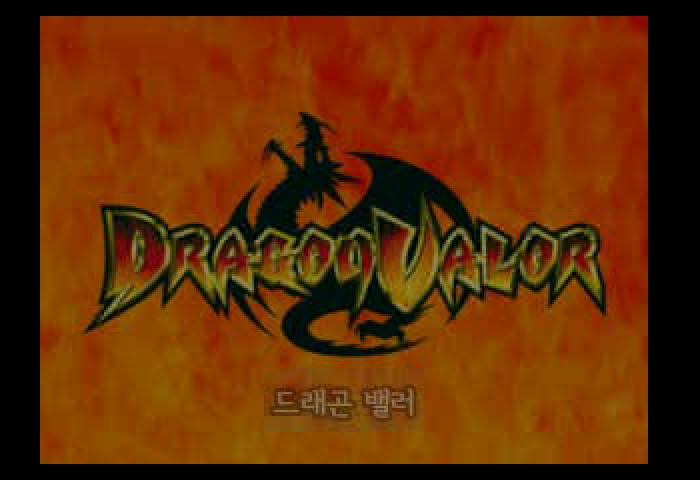
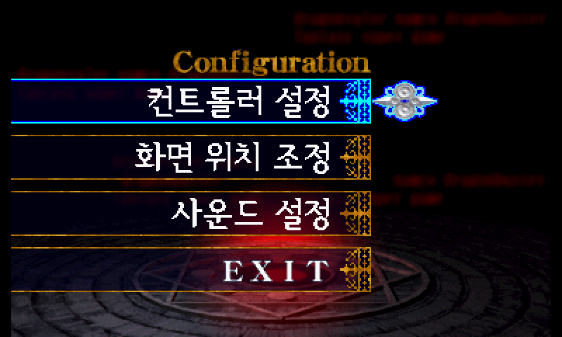
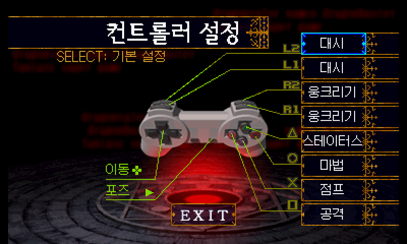
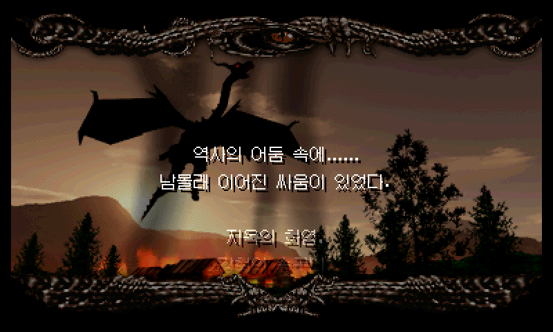
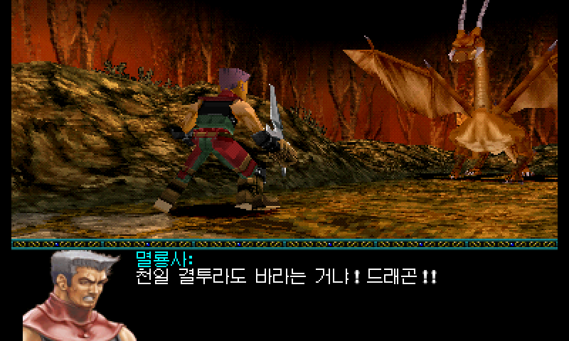
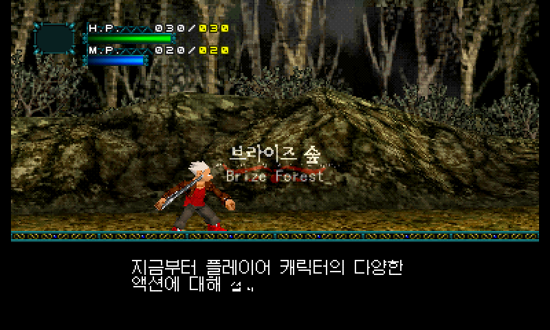
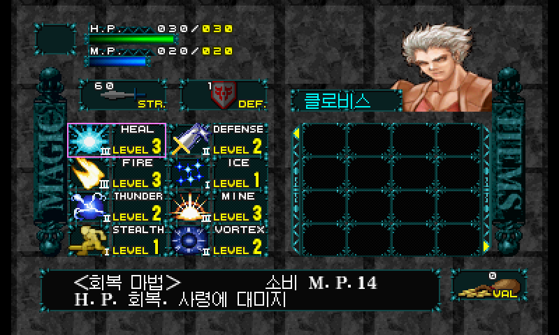
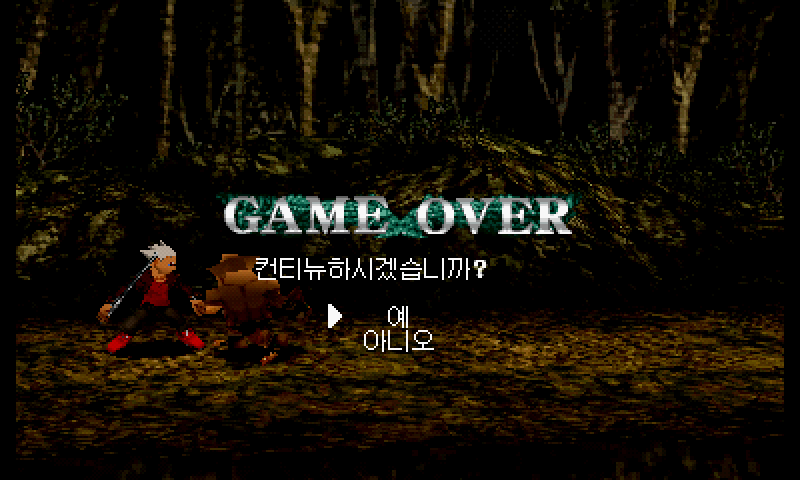

# 드래곤 밸러 (PS1) 비공식 한글패치

PS1 일본판 **ドラゴンヴァラー (드래곤 밸러, SLPS-02190/02191, 2디스크)** 비공식 한국어 패치입니다. 이 저장소에는 제작 도구와 기술 문서만 있고, 패치 파일(xdelta)은 [Releases](../../releases)에서 받을 수 있습니다. 게임 원본·일본어 원문·번역 대본은 포함하지 않습니다.


## 게임 소개

『드래곤 밸러』는 남코가 1999년에 낸 3D 액션 RPG입니다. 여동생을 잃은 멸룡사 클로비스에서 시작해, 그 피를 이은 후손들이 대를 이어 드래곤과 싸우는 이야기를 그립니다. 장이 끝날 때마다 주인공이 결혼하는 상대에 따라 다음 세대의 주인공과 이야기가 달라지는 「세대 교체」 구성이 특징입니다.

## 적용 방법
1. 아래 해시와 일치하는 **원본 `.bin`/`.cue`** (Redump 형식, 디스크당 단일 트랙)를 준비합니다. (CHD·PBP·ECM 등으로 변환한 이미지에는 적용할 수 없습니다.)
   - PowerShell: `Get-FileHash -Algorithm MD5 -LiteralPath '.\Dragon Valor (Japan) (Disc 1).bin'`
2. xdeltaUI 같은 도구로 디스크마다 xdelta를 적용합니다. (Patch = xdelta, Source File = 원본 BIN, Output File = 새 파일명)
   - 명령줄:
     ```
     xdelta3 -d -s "Dragon Valor (Japan) (Disc 1).bin" Dragon_Valor_KO_v1.0_Disc1.xdelta "Dragon Valor (Korean) (Disc 1).bin"
     xdelta3 -d -s "Dragon Valor (Japan) (Disc 2).bin" Dragon_Valor_KO_v1.0_Disc2.xdelta "Dragon Valor (Korean) (Disc 2).bin"
     ```
3. 원본 `.cue` 를 복사해 이름을 바꾸고 `FILE "..."` 줄을 새 `.bin` 파일명으로 고칩니다.
4. 만들어진 `.cue` 를 DuckStation 등 PS1 에뮬레이터나 ODE 장치에서 실행합니다.

| 항목 | 디스크 1 | 디스크 2 |
| --- | --- | --- |
| 원본 BIN 크기 | 635,228,160 바이트 | 700,801,920 바이트 |
| 원본 BIN MD5 | `446c789aae42e95bc8056597d65b1f7c` | `a1cf16b83cb39230b800eda2210c6f79` |
| 원본 BIN SHA-1 | `82f33fd5f1c69c8e61de9e5f5645c9f722480615` | `e905099892a6cebeee9ad838894b02c182b44bf3` |
| xdelta 크기 | 3,348,764 바이트 | 3,398,304 바이트 |
| xdelta SHA-256 | `26ca26a80e835328f25bb89d14bc90620676194ffd758f5864f75d1165d2b50d` | `27ed55cac006165d03e70ad435f1cb04a0e744aca70e0abf5b5f3b30353bbc7b` |
| 결과 BIN MD5 | `8d25387c3e53c88749e217e6cf072c6e` | `922b7dd27eef23238767532bad17dd50` |
| 결과 BIN SHA-256 | `ba74adb75a7a1b9e4246db5659c1d3b8423a0928f6e5775b39ae0912fd8f66d1` | `2bacabbfaca1b0f2370a242c7e0affff12e555843478e48320b9cb3273a91718` |

## 주의
- 원본에서 만든 **상태저장(세이브 스테이트)** 은 불러오지 마세요. 글꼴 배치가 달라 글자가 깨집니다. 메모리 카드 세이브는 그대로 쓸 수 있습니다.
- xdelta는 압축하지 않은 형식입니다(디스크당 약 3.4MB).

## 한글화 내용
- 이벤트 대사·화자 이름·선택지·튜토리얼·장 사이 스크롤 문장 등 고유 문장 **1,980개 전체** 직접 번역 (양 디스크 3,331개 항목)
- 아이템·마법 설명문 201종, 메모리 카드 메시지, 후계자 이름 9명, 게임오버 컨티뉴·세이브 확인 문구
- 글꼴: 갈무리11 원래 크기(12px)로 고정 글꼴 한글 308자 + 장면별 한자 페이지 193장에 장면에 필요한 음절 배치
- 그림 글자: 장 제목 카드 13장, 지역명 92종, 월드맵 장·스테이지 목록 13종, 가계도 이름표 11장, 설정 메뉴(컨트롤러·화면 위치·사운드), 디스크 교체 안내
- 타이틀 화면과 오프닝 동영상 마지막 로고 장면(디스크당 115프레임)에 작은 「드래곤 밸러」 표기 (STR v3 재인코딩)
- 글꼴: 본문 갈무리11, 장 제목·지역명·설정 메뉴 제목 서울한강체

## 그대로 둔 것
- 원래 영문인 그래픽(PAUSE, GAME OVER, ENEMY, 메뉴 MAGIC/ITEMS, 지역명 영문 부제 등)
- 오프닝 동영상의 음악 (대사 음성 없음)
- 개발용으로 남은 미사용 문자열(DUMMY 등)과 어느 글꼴 페이지에도 맞지 않는 미사용 대사 블록

## 검증 범위
DuckStation 호환 코어(mednafen)에서 오프닝 동영상, 타이틀, 로드 화면, 설정 메뉴 전체, 프롤로그 스크롤, 드래곤 대화, 첫 스테이지 튜토리얼과 대사, 메뉴의 마법·아이템 설명, 게임오버 컨티뉴 화면, 디스크 2 데모를 확인했습니다. 월드맵·가계도·상점 화면은 디스크에 들어간 텍스처를 렌더링해 확인했고, 게임 안에서 해당 장면을 띄워 보지는 못했습니다. 전체 플레이 검증은 하지 않았습니다. 문제를 발견하면 Issues에 알려 주세요.

## 스크린샷
| | |
| --- | --- |
|  |  |
|  |  |
|  |  |
|  |  |

## 문서
- [CHANGELOG.md](CHANGELOG.md) — 변경 기록
- [docs/TECHNICAL.md](docs/TECHNICAL.md) — 파일 형식과 한글화 방법
- [docs/BUILD.md](docs/BUILD.md) — 직접 빌드하는 방법
- [docs/FONT_CREDITS.md](docs/FONT_CREDITS.md) — 글꼴
- [RIGHTS.md](RIGHTS.md) — 권리 및 외부 자료
